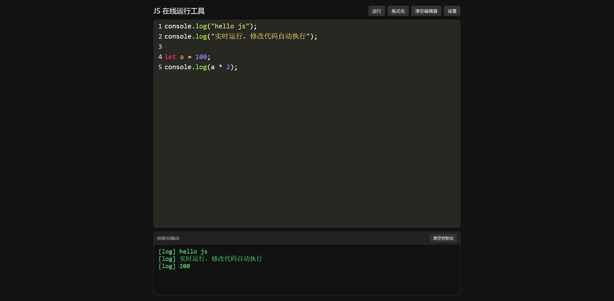
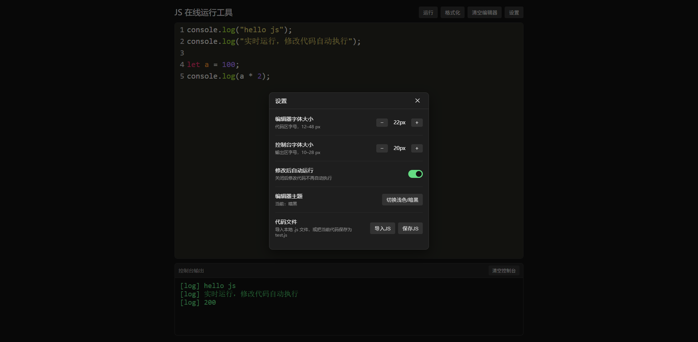
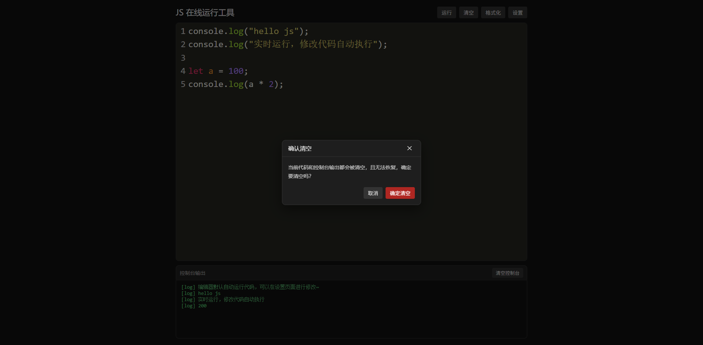

# js-runner

一个可以直接在浏览器里编写、测试、格式化 JS 代码在线运行工具，基于 CodeMirror 构建，开箱即用，纯前端无后端，适合快速验证代码片段、调试小脚本。

## ✨ 功能特性

- ✅ 代码自动运行（防抖执行，iframe 隔离环境，安全沙箱），可在设置中关闭，并用工具栏「运行」按钮手动执行
- ✅ 代码智能提示、自动补全（JS 语法提示，并包含当前文件内自己声明的变量 / 函数 / 参数；对象字面量与类实例的成员也能提示）
- ✅ 括号、引号自动补全
- ✅ Prettier 一键代码格式化
- ✅ 编辑器、控制台字号独立调节（12–48 px / 10–28 px）
- ✅ 设置面板统一管理：字号、自动运行开关、主题、文件导入导出
- ✅ 本地持久化：代码、主题、字号、自动运行开关，刷新页面不丢失
- ✅ 导入本地 `.js` 文件、导出下载代码文件
- ✅ 暗黑 / 浅色双主题切换
- ✅ 行号显示、自动换行
- ✅ 控制台输出日志、捕获运行错误
- ✅ Tab / Shift+Tab 缩进控制，Ctrl+/（macOS 为 Cmd+/）注释 / 取消注释

首页效果展示：



设置页面展示：



清空弹窗展示：



## 📦 技术栈

- CodeMirror 5：代码编辑器

- Prettier 3：代码格式化

- acorn-loose 8：容错 JS 解析，用于收集当前文件内声明的变量 / 函数名并参与自动补全（加载失败时自动退回正则扫描）

- 原生 HTML / JavaScript，无打包、无依赖安装

- localStorage 本地存储

- iframe 隔离执行代码

## 🚀 快速使用

1. 克隆仓库

```bash

git clone https://github.com/heidouya/js-runner.git

cd js-runner

```

2. 直接打开 `index.html` 即可使用

> 不需要 npm、不需要启动服务，本地双击打开就能跑（CodeMirror、Prettier 走 CDN，首次打开需要联网）。

## 📖 使用说明

1. 在编辑器区域编写 JavaScript 代码

2. 修改代码后自动延迟运行，结果打印在下方控制台

3. **运行**：立即执行当前代码，不受「修改后自动运行」开关影响

4. **格式化**：一键整理代码缩进、空格、换行；代码语法错误时会提示格式化失败

5. **清空编辑器**：一键清空编辑区，同时清空控制台

6. **设置**：打开设置面板，集中管理以下选项

   - **编辑器字体大小**：代码区字号，12–48 px，`−` / `+` 调节，改动即时生效
   - **控制台字体大小**：输出区字号，10–28 px，`−` / `+` 调节，改动即时生效
   - **修改后自动运行**：开关，关闭后改代码只保存不执行，需要点工具栏「运行」手动执行
   - **编辑器主题**：显示当前主题，一键切换暗黑 / 浅色
   - **代码文件**：导入本地 `.js` 文件；把当前代码保存为以当前时间命名的文件，如 `2026-11-11-00-15-30.js`

7. 代码、主题、字号和自动运行开关都保存在浏览器本地存储，关闭页面下次打开内容还在

## ⚠️ 注意事项

- 代码运行在 iframe 隔离环境，仅用于 JS 片段测试

- 本工具**纯前端**，所有代码只保存在你自己浏览器，不会上传到任何服务器

- 代码编辑器与格式化能力通过 CDN 加载（jsDelivr / unpkg），离线状态下页面无法正常使用

- 语法错误会直接在控制台打印报错信息，方便定位问题

- 格式化依赖 Prettier，代码语法非法时格式化会失败

## 📝 示例代码

```javascript
console.log("hello js");
console.log("实时运行，修改代码自动执行");

let a = 100;
console.log(a * 2);
```

## 🤝 欢迎 Star \& Fork

如果你觉得这个工具好用，欢迎点个 Star ⭐，有问题或者新需求可以提 Issue。